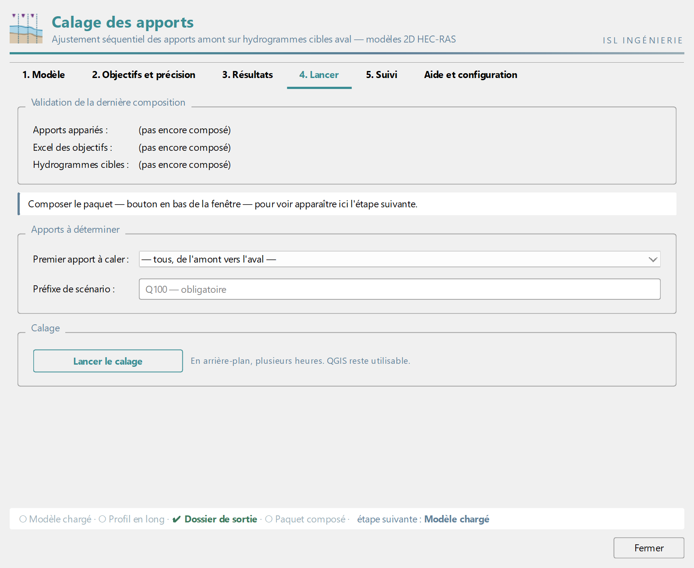

# Calage_apports

**23 octobre 2026 — version 0.9.20, prête pour le dépôt d'extensions PIO**
(`file://sudouest/users/perrin/16-Dev/1-Utilitaires/1.1-Plugins_QGIS/00-depot_QGIS/plugins.xml`),
qui diffuse la 0.9.19 jusqu'à sa publication. Le lot UX B/C
([PR #3](https://github.com/CedricPerrin/Calage_apports/pull/3), fusionnée le
20 septembre) est dans l'archive depuis la 0.9.13 : effets du contrôle explicités ;
installation Python dans une tâche QGIS avec journal et protection contre les doubles lancements.
Voir [les changements, contrôles et limites](docs/UX_ISL.md) et le
[suivi d’intégration](https://github.com/CedricPerrin/ergonomie/blob/main/SUIVI_LOTS_2026-09-20.md). Les preuves antérieures ci-dessous restent datées ;
la recette visuelle et métier sur le poste ISL reste à réaliser, dans le profil `ISL`,
extension installée depuis le dépôt.

Ajustement séquentiel d'apports amont sur des hydrogrammes cibles aval, pour
les modèles 2D HEC-RAS — chaîne Python + plugin QGIS. Projet ISL Ingénierie.

Version des sources du plugin : **0.9.27**. La
[note d’ergonomie du 11 septembre 2026](docs/ergonomie_2026-09-11.md)
décrit le parcours, les choix d’interface et les points de recette.

La version 0.8.0 a passé **248 contrôles Qt** et **30 scénarios d'affichage**
dans QGIS 3.44.8, dont petites fenêtres, thème sombre et écran à 150 %.
La chaîne hydraulique reste inchangée ; aucun nouveau calage réel n'a été
lancé pour cette révision. [Mesures de la recette](docs/ergonomie_2026-09-11-mesures.json).
La **0.8.2** en passe **258, sans échec** : le débordement horizontal de
l'onglet Objectifs à 13 points, présent depuis la 0.8.0, est corrigé.
Elle remplace trois aides dépliables maison par des groupes repliables
QGIS, les boîtes d'information par un bandeau de messages, et retient la
taille de la fenêtre d'une session à l'autre.
La **0.8.3** en passe **270, sans échec** : relancer un calage demande par où
reprendre — les apports déjà calés en amont du départ sont conservés — et
l'onglet Suivi garde le calage précédent au lieu de l'écraser.
La **0.8.4** en passe **278, sans échec** : le préfixe de scénario nomme
l'Excel des objectifs — `donnees_calage_Q100.xlsx` —, si bien que deux
scénarios d'un même dossier de sortie ont deux classeurs ; les erreurs et
avertissements du journal de lancement remontent dans l'onglet Suivi ; et
HEC-RAS ouvert refuse le lancement au lieu de poser une question.
La **0.8.5** vient d'une [relecture ergonomique du 17 septembre](docs/ergonomie_2026-09-17.md)
menée avec la grille du dépôt `ergonomie` : l'onglet Suivi suit le thème
sombre — ses widgets peints et son tableau gardaient les couleurs du clair,
ardoise à 2,3:1 et rouge à 1,8:1 sur Night Mapping — et la police du
poste ; les quatre questions Oui/Non ont un défaut sûr et des verbes ; le
teal institutionnel ne sert plus de couleur de texte ; les liens du fil
conducteur se prennent au clavier. Le banc gagne 23 contrôles, **non
rejoués** : cette version a été écrite sans QGIS, et son premier passage au
banc reste à faire.
La **0.8.6** fusionne la revue de qualité de la 0.8.4 menée le 17 sur une
branche : `classeur` en propriété, journal du Suivi relu seulement s'il a
changé, `noyau.dernier_journal`, compte rendu HEC-RAS coupé au tableau des
temps, `plan_fenetre_pleine` en reprise seulement. Rien de visible ne
change ; le banc QGIS reste à rejouer.

La **0.8.7** porte les lots UX B et C du 20 septembre : le fil conducteur
annonce ce que le bouton de contrôle écrit dans la géométrie, et
`installation.py` confie la création du venv, `pip` et la vérification à un
`QgsTask` — phases affichées, journal dans celui de QGIS, réglage retenu
seulement après succès vérifié, double lancement refusé. Ni annulation au
milieu de `pip`, ni recherche d'interpréteurs asynchrone. Banc sous QGIS
3.44.7 / Qt 5.15.13 : **299 contrôles réussis** ;
[détail et limites](docs/UX_ISL.md).

La **0.8.8** remplace une déduction par deux faits. Le champ
`Short Identifier` d'un plan — dont RAS Mapper fait le nom du dossier de
résultats — accepte **au moins 40 caractères** sous HEC-RAS 7.0.1, là où la
chaîne s'arrêtait à 30, le plus long exemple d'un relevé de 103 plans. Mais
le plafond utile est **32**, et il vient de `ras-commander` 0.99.1, qui lève
`ValueError` au-delà sur `Plan Title` et `Flow Title` : la borne est celle de
la bibliothèque, pas du format. Et le
contrôle du classeur éprouve le titre de **reprise** pour chaque départ
possible : il ne jugeait que « Premier_apport », qui s'écrit au lancement,
donc après lui.

La **0.9.0** repond a trois demandes du 20 septembre. L'onglet **Sorties**
disparait : ses groupes rejoignent **Lancer**, apres les apports a determiner,
et le **prefixe de scenario** vient se poser juste au-dessus du bouton — cinq
rubriques au lieu de six. Le lancement **dit ce qu'il va faire** avant le clic :
d'ou le calage repart, de quel plan d'etape, quels apports sont tenus pour
cales et lesquels seront calcules. Et la feuille **« Parametres » quitte
l'Excel** : les valeurs vivent dans un JSON qui porte le nom du classeur, a
cote de lui ; leurs commentaires descendent dans la feuille de garde. Les
classeurs composes avant cette version sont **encore lus par leur feuille**.

La **0.9.2** : recomposer **met l'ancien classeur de cote, horodate**, au
lieu de le reecrire en place — le nom canonique ne bouge pas ; l'ecran
**nomme les reglages qui ne concordent plus** avec le paquet compose, car
c'est le paquet que le calage lit ; et le Suivi porte le **journal en
cours**, deroulant, a cote de l'encadre des alertes qui, lui, ne retient
que les lignes portant un mot d'alerte.

La **0.9.3** fait apparaitre le resultat dans **RAS Mapper**. Un calage
abouti laissait un plan « <prefixe>_avec_apports » avec son `.pNN.hdf`
complet, et RAS Mapper ne montrait rien : son arbre *Results* liste ce que
le `.rasmap` declare, et ras-commander ne l'ecrit jamais. `conclure()`
inscrit maintenant le plan final dans ce fichier. **L'affichage dans RAS
Mapper lui-meme n'a pas ete verifie.**

La **0.9.4** : le prefixe de scenario rejoint le groupe du fichier qu'il
nomme, renomme **Hydrogrammes cibles** ; l'**emprise 2D** arrive en contour
rouge sans remplissage, au lieu de masquer le maillage et les sections ; les
listes d'etapes de l'aide disent le bon ordre — le dossier de sortie **apres**
les objectifs ; et changer de prefixe avant de recomposer **s'annonce**, avec
le nom du fichier ou les hydrogrammes deja saisis se trouvent encore.

La **0.9.5** rend la composition **automatique** : composer le paquet et
lancer les controles se font seuls des qu'un reglage change, et le bandeau
nomme ce qui a ete reporte. Le bouton du bas ne garde que le **seul geste
irreversible** — ecrire les couches dans la geometrie HEC-RAS — et porte
desormais ce nom. La sauvegarde du classeur passe a un seul niveau,
`…​.precedent.xlsx` : automatique, un horodatage par frappe enterrerait le
dossier de sortie.

La **0.9.6** ramène le bouton d'écriture à l'étape **Modèle** : puisqu'il ne
compose plus rien, ce qu'il consomme tient tout entier dans cet onglet, et ce
qu'il écrit s'y dessine. Elle corrige aussi un défaut de la 0.9.5 : la
recomposition automatique pouvait se **ré-entrer** et arrêter le processus
sans trace.

La **0.9.7** (22 septembre 2026) lit le **poste** et propose le nombre de
cœurs à demander à HEC-RAS. L'étape Lancer gagne un groupe « Calcul
HEC-RAS » : une case « Demander N cœurs à HEC-RAS pour chaque calcul »,
décochée par défaut, et sous elle ce qui a été détecté, ce que le plan de
référence demande (`UNET D2 Cores`) et ce que cocher changera — ou pas : sur
un processeur hybride, HEC-RAS 7.0.1 n'emploie que les cœurs de performance
quoi qu'on lui demande. Cochée, la chaîne passe `num_cores` à
`compute_plan`, et ras-commander (`RasPlan.set_num_cores`, relu sur GitHub)
réécrit `UNET D1 Cores`, `UNET D2 Cores` et `PS Cores` dans chaque **plan
d'étape** avant son calcul ; le plan de référence n'est pas touché. La
suggestion est le nombre de cœurs utiles, plafonné à 8 (recommandation
ras-commander, non mesurée ici). La même version corrige la **couverture**
de `criteres.diagnostiquer`, qui comptait le décalage deux fois quand le
modèle répond avant la cible : sur un calage réel de onze apports à 100 % de
volume, neuf « ne couvre que 45 à 90 % » à tort — voir `CHECKPOINT.md`.

La **0.9.8** (22 septembre 2026) fait exister l'Excel des objectifs **dès la
saisie du préfixe**. Le dossier de sortie était un préalable de la
composition automatique, mais son champ vit à l'étape Lancer, après les
Objectifs : vide, il retenait tout. Il se propose désormais tout seul dès que
le modèle et le préfixe sont connus — `_calage\<préfixe>` à côté du modèle,
un dossier par scénario — et une valeur saisie à la main n'est jamais
remplacée. L'Excel est ensuite mis à jour à chaque recomposition, ses
cibles préservées.

La **0.9.9** (22 septembre 2026) corrige un plantage de la **recomposition
automatique**, présent depuis la 0.9.5 et jamais vu au banc : le décorateur
`avec_sablier` n'acceptait aucun argument, et le minuteur de recomposition
appelle `_composer_et_controler` avec deux mots-clés — `TypeError` à la
première recomposition sur le poste de calcul. L'enveloppe transmet
désormais les arguments — mais seulement ceux que la méthode déclare : deux
méthodes au sablier sont branchées sur `clicked`, dont le booléen, transmis
tel quel, faisait mourir le processus sans trace (une exception dans un slot
PyQt est fatale). Le banc appelle la méthode comme le minuteur et comme un
clic. Le texte d'attente de l'étape Lancer ne renvoie plus à un bouton « en
bas de la fenêtre » qui vit à l'étape Modèle depuis la 0.9.6.

La **0.9.10** (22 septembre 2026) répond à trois demandes du poste de calcul.
**Un seul bouton**, « Valider la géométrie et générer le fichier des
hydrogrammes », **sous le préfixe de scénario** : il écrit la géométrie,
compose le classeur et contrôle, avec compte rendu — la composition
automatique (0.9.5) renonce en silence dès qu'un préalable manque, et
« Ouvrir dans Excel » restait gris après le préfixe sans que rien ne dise
pourquoi ; le bouton, gris tant qu'il manque quelque chose, le nomme dans
son infobulle et dans son refus. Le bouton « Écrire dans la géométrie
HEC-RAS » de l'étape Modèle disparaît, absorbé. Le **dossier de sortie**
remonte juste au-dessus de « Hydrogrammes cibles » : on sait où va l'Excel
avant de le nommer. Et l'onglet **« 2. Objectifs » devient « 2.
Paramètres »**.

La **0.9.11** (22 septembre 2026) ne change qu'un texte, sur une mesure : la
case des cœurs cochée sur une **station à 32 cœurs** a demandé 8, et HEC-RAS
7.0.1 en a employé **8** (« Maximum number of cores = 8 »), simulant 48 h en
1 h 48 — 26,4 fois le temps réel, contre 7,4 sur le portable à 4 cœurs P où
le plan disait « tous » (autre crue : comparaison indicative). L'étiquette
sous la case ne prétend plus savoir ce que « tous » donne ; elle dit qu'un
nombre demandé est honoré.

La **0.9.12** (23 septembre 2026) corrige un défaut de la 0.9.2 : quand la
composition refusait d'écrire — feuille Cibles saisie sans en-tête
« Temps_h » — l'ancien classeur avait déjà été renommé en `.precedent.xlsx`,
et le fichier canonique disparaissait alors que le message promettait « le
classeur n'est pas touché ». La mise de côté se fait désormais juste avant
l'écriture, après le garde-fou ; le banc de `noyau.py` vérifie qu'un refus ne
crée aucune copie. Défaut invisible deux jours : la CI, bloquée par le quota
GitHub Actions du 20 au 23 septembre, ne l'a montré qu'à sa reprise.

La **0.9.13** (23 septembre 2026) reprend la PR #4 de Codex (20 septembre),
rebasée : au clic « Installer l'interpréteur », la **recherche des Python
candidats** — chacun exécuté pour être validé — tournait sur le fil graphique
et pouvait figer la fenêtre. Elle passe dans une tâche QGIS : progression dans
le diagnostic, annulation entre deux sondes depuis le gestionnaire de tâches,
cible confirmée figée, résultat conservé si la fenêtre est fermée et proposé à
sa réouverture. Le choix reste sur le fil graphique ; aucune installation
implicite après annulation ou erreur. Un test de sondes hors QGIS et trois
scénarios QGIS natifs l'éprouvent en CI.

La **0.9.14** (24 septembre 2026) rend le changelog lisible par QGIS. Ses
quinze signes pour cent, présents depuis la 0.5.0, n'étaient pas doublés :
QGIS lit `metadata.txt` avec interpolation et rendait une erreur pour ce champ,
d'où un historique vide dans le gestionnaire d'extensions. `faire_zip.py`
relit désormais chaque champ comme QGIS et refuse l'archive sinon ;
`essai_garde_fou_archive.py` l'éprouve. Aucun changement de comportement du
plugin.

La **0.9.15** (24 septembre 2026) retire la **recomposition automatique** de
la 0.9.5 : partie 1,5 s après la dernière frappe, elle composait les préfixes
à demi tapés — taper « Q100 » en marquant une pause créait `_calage\Q1\`, son
classeur et ses shapefiles. Seul le bouton compose désormais. Un réglage changé
ensuite porte un **« ! » rouge** sur son champ et sur le titre de son étape ;
le sens de l'axe, le PK d'origine, la zone 2D, la géométrie, le flux et la
fenêtre de simulation sont comparés à leur tour, et le lancement est refusé
tant qu'un « ! » reste allumé. Un champ que l'écran n'a jamais renseigné —
un Excel repris sans son modèle — n'allume rien : seul ce qui a bougé depuis
l'arrivée du paquet compte. Les couches de PK sont **remplacées** au lieu de
s'empiler, au style des couches de base, avec l'étiquette du PK. Et la case
de suppression des plans d'étape, cochée après la composition, était ignorée :
elle s'écrit au lancement. Banc QGIS : **376 contrôles, aucun échec**.

La **0.9.16** (24 septembre 2026) remplace « Reprendre un Excel… » par
**« Importer des hydrogrammes d'un calcul précédent »** : il recopie, dans
l'Excel de ce calcul, les hydrogrammes des sections de même nom et les pentes
des apports de même nom — rien d'autre : la fenêtre garde son classeur et ses
réglages. Sans cible commune, il le dit et n'écrit rien ; sinon il nomme les
hydrogrammes importés et les colonnes restées vides. Les couches « Sections —
PK » et « Injections — PK », qui doublaient les couches de base,
disparaissent : le PK s'affiche en étiquette « nom — PK » sur celles-ci. Et la
fenêtre ne change plus d'onglet d'elle-même après une composition ou un
lancement.

La **0.9.18** (21 octobre 2026) reprend l'audit du 11 octobre : le ménage
garde le dossier de sortie, un fichier HEC-RAS réécrit garde son encodage et
ses octets (clones ras-commander compris), et le projet chargé est le `.prj`
désigné, pas le premier du dossier.

La **0.9.20** (23 octobre 2026) propose un préfixe qui commence par le
cours d'eau, « Riviere - Q100 » : les étapes s'écrivent alors
« Riviere - Q100 - sans_apport », et deux cours d'eau calés pour la même
crue ne partagent plus leurs plans. Les liens du fil conducteur mènent au
champ à remplir ; textes, nombres et dates sont revus. Aucun changement de
calcul.

La **0.9.19** (23 octobre 2026) met le bouton « Calage apports » dans la barre
d'outils « CPN », commune aux extensions de la maison, et donne à la fenêtre
l'esthétique commune de Rhoé et Hyétos : étapes dans la bande de gauche,
graphiques du suivi aux couleurs du registre commun, disposition qui tient à
13 pt. Aucun changement de calcul.

La **0.9.17** (28 septembre 2026) corrige deux défauts vus sur le calage
Suhi-Q100. RAS Mapper nomme la couche de résultats d'après les attributs du
`.pNN.hdf` : le plan final y apparaissait sous le nom de la dernière étape.
`conclure()` réécrit donc aussi ces attributs. Par ailleurs, la case de
suppression des plans d'étape n'agit que sur un calage conforme, puisque la
reprise a besoin de ces plans. Sur un calage non conforme, le journal le dit
désormais par un avertissement.

Pour chaque apport, de l'amont vers l'aval : estimer, calculer, comparer à la
cible, corriger, répéter jusqu'à concordance, puis vérifier la cohérence des
sections amont avant de passer au suivant.

**Le réseau ne comporte pas de boucle hydraulique : c'est une hypothèse du
modèle, posée par l'hydraulicien, et rien dans la chaîne ne la vérifie.**
L'ordre total amont → aval est ce qui donne un sens à « section suivante » ;
sur un réseau bouclé — bras qui se rejoignent, casiers interconnectés — un
apport alimenterait plusieurs sections par des chemins distincts, et la
méthode ne s'applique pas. Confirmée par l'hydraulicien le 8 septembre 2026
pour les modèles en cours. Les hypothèses de validité sont au § 1.2 de la
note méthodologique.

Le calage laisse dans le modèle **un plan HEC-RAS par étape** —
`Q100_sans_apport`, `Q100_Apport_A1`… puis `Q100_avec_apports`, qui n'est pas un
clone mais la dernière étape retitrée, avec ses résultats. Ils sont conservés :
ils documentent le calage et permettent de reprendre une séquence interrompue.
Dans **Lancer**, une case permet leur suppression **sur demande**,
uniquement après un calage réussi.

La boucle ([src/calage.py](src/calage.py)) est **indépendante du solveur** : elle
n'en connaît qu'une interface de neuf méthodes, dont six à écrire. Elle est donc
testable sans HEC-RAS, dont la déclinaison vit dans
[src/pilote_hecras.py](src/pilote_hecras.py).

## Démarrage

```bat
REM Un Python ORDINAIRE — surtout pas celui de QGIS : voir ci-dessous.
pip install -r requirements-dev.txt
cd src
python verification_environnement.py
```

`verification_environnement.py` contrôle tout ce qu'exige la mise en œuvre —
interpréteurs, dépendances, fichiers — et nomme ce qui manque.

[requirements-dev.txt](requirements-dev.txt) dit ce qu'il faut pour travailler
sur le code, et surtout ce qui n'y est **pas** : `ras-commander` et `h5py` vivent
dans un interpréteur séparé (conflit HDF5 avec QGIS), `qgis` et `PyQt` viennent
de l'installation QGIS.

Pour saisir les données d'un calage, partir de
[template_donnees_calage.xlsx](template_donnees_calage.xlsx) **et de son
[template_donnees_calage.json](template_donnees_calage.json)** — le classeur
porte la correspondance et les cibles, le JSON porte les paramètres, et les
deux se déplacent ensemble. La feuille de garde du classeur explique chaque
paramètre. Puis lancer la chaîne en ligne de commande ou depuis le plugin.

### Avec quel Python ?

Le dépôt en côtoie trois, et les confondre donne des diagnostics qui ressemblent
à des pannes.

| à lancer | avec quoi |
|---|---|
| `verification_environnement.py` | un Python **ordinaire**, ou celui du `venv-hecras` |
| `test_plugin_qgis.py` | le **Python de QGIS** (`python-qgis-ltr.bat`) — il construit la fenêtre |
| les auto-tests de `src/*.py` | l'un ou l'autre, selon leurs imports |

Sous le Python de QGIS, `verification_environnement.py` rend `DLL load failed
while importing _errors` sur `ras-commander`. **Ce n'est pas une panne** : QGIS
embarque sa propre bibliothèque HDF5, et `h5py` y est inutilisable — c'est
précisément la séparation que le projet impose.

## Structure du dépôt

`src/` porte la chaîne Python. C'est un dossier de développement, pas un paquet
distribué : le plugin en embarque une copie autonome à l'installation.

| Fichier / dossier | Rôle |
|---|---|
| [src/calage.py](src/calage.py) | Boucle de calage séquentiel |
| [src/criteres.py](src/criteres.py) | Analyse pure : recalage temporel, corrélation de forme, diagnostic |
| [src/parametres.py](src/parametres.py) | Les paramètres d'un calage : le JSON voisin du classeur, et la lecture des classeurs d'avant |
| [src/controle_donnees.py](src/controle_donnees.py) | Validation du classeur et de la chaîne SIG avant tout calcul |
| [src/geometrie.py](src/geometrie.py) | Shapefiles, PK par projection curviligne, écriture dans la géométrie HEC-RAS |
| [src/livrables.py](src/livrables.py) | Graphiques, tableaux, export Excel, note de synthèse |
| [src/suivi.py](src/suivi.py) | Avancement lisible pendant le calcul |
| [src/pilote_hecras.py](src/pilote_hecras.py) | Déclinaison HEC-RAS de l'interface `Modele` |
| [src/pont_hecras.py](src/pont_hecras.py) | Pont en ligne de commande répondant en JSON — `ras-commander` est inimportable dans le processus QGIS |
| [src/creer_template.py](src/creer_template.py) / [src/style_classeur.py](src/style_classeur.py) | Fabrication et mise en forme du classeur de saisie |
| [src/verification_environnement.py](src/verification_environnement.py) | Contrôle de l'environnement |
| [src/faire_zip.py](src/faire_zip.py) | Construit `calage_apports_<version>.zip`, l'archive d'installation — le numéro vient de `metadata.txt`, et l'archive précédente est retirée |
| [src/essai_garde_fou_archive.py](src/essai_garde_fou_archive.py) | Essai **adverse** : injecte trois fautes dans l'archive et vérifie qu'elles sont refusées |
| [src/test_plugin_qgis.py](src/test_plugin_qgis.py) | Suite du plugin, sous le Python de QGIS et sur une **copie** d'un modèle — elle **modifie** la géométrie de celui qu'on lui donne (voir ci-dessous) |
| [src/reference_calage_fictif.json](src/reference_calage_fictif.json) | Sortie figée d'un calage sur `ModeleFictif`, comparée à chaque passage du banc. **Ne pas modifier à la main** : `python calage.py --figer-reference` la réécrit |
| [src/elaguer_projet.py](src/elaguer_projet.py) | Rattrapage : élague les plans laissés par l'**ancienne** chaîne |
| [src/reconstruire_livrables.py](src/reconstruire_livrables.py) | Rattrapage : reconstruit les livrables d'un calage **terminé**, en lecture seule sur le modèle |
| [src/captures_plugin.py](src/captures_plugin.py) | Refait les six captures de ce README, sous le Python de QGIS — une capture périmée ressemble à une capture |
| `src/figures_note/` | Reconstruction de la note méthodologique |
| [methodologie_calage_amont_aval.docx](methodologie_calage_amont_aval.docx) | Note méthodologique : mode opératoire, méthode, application HEC-RAS/QGIS, livrables |
| `calage_apports_<version>.zip` | **L'archive à installer dans QGIS** — son nom porte la version, prête à l'emploi |
| `calage_apports/` | Sources du plugin QGIS — voir son [LISEZMOI.md](calage_apports/LISEZMOI.md) |
| [STATUT.txt](STATUT.txt) | État courant et règles en vigueur — la référence pour le détail |
| `charte/` | Identité graphique ISL Ingénierie |

### Lancer la suite du plugin

```bat
"…\bin\python-qgis-ltr.bat" test_plugin_qgis.py --modele "<dossier du modèle>"
```

Sans `--modele`, elle tourne quand même et annonce ce qu'elle saute. `--plan` et
`--geometrie` se déduisent du dossier — mais la déduction prend le **premier**
fichier par ordre alphabétique : les passer explicitement dès qu'un projet porte
plusieurs plans. `--objet <nom d'une condition limite>` ouvre une section de
plus. Le modèle doit porter au moins une ligne d'injection et une ligne de
référence, la seconde en **aval** de la première.

### Publier une version

Le plugin est diffusé par le dépôt d'extensions PIO,
`file://sudouest/users/perrin/16-Dev/1-Utilitaires/1.1-Plugins_QGIS/00-depot_QGIS/plugins.xml`, à déclarer une fois dans
QGIS. Pour une nouvelle version :

1. Monter `version=` dans `calage_apports/metadata.txt`, avec son entrée de
   changelog — un « % » s'y écrit « %% ».
2. Construire l'archive avec l'outil du projet : `python src\faire_zip.py`.
3. Double-cliquer `D:\1-Dev\1-Utilitaires\1.1-Plugins_QGIS\00-depot_QGIS\outils\publier.bat`.

Le `LISEZMOI.md` de ce dossier détaille la marche à suivre.

## La fenêtre du plugin

Cinq rubriques : **Modèle → Paramètres → Lancer → Suivi**, puis
**Aide et configuration**. Les commandes de navigation restent
accessibles en bas de la fenêtre. Les pages longues défilent ; les détails
secondaires se déplient à la demande. Au bas de la fenêtre, **une barre
compte les quatre étapes de la saisie avant lancement** — modèle, profil en
long, dossier de sortie, paquet composé — à côté du bouton qu'elle prépare ;
elle ne dit rien du calage lui-même, qui se lit à l'étape Suivi. Le fil
conducteur, juste au-dessus, ne porte plus que la prochaine étape et son
lien : le compte s'y lisait une seconde fois. Les images sont produites avec un
projet de démonstration par [src/captures_plugin.py](src/captures_plugin.py).

> **Les captures datent de la 0.8.2 et ne montrent plus la fenêtre.** La
> 0.9.0 supprime l'onglet Sorties, déplace le préfixe de scénario et ajoute
> le récapitulatif de reprise ; avant elle, la 0.8.3 avait ajouté le statut
> « repris » au Suivi et la 0.8.5 changé le libellé du préfixe. **Seul
> l'onglet 1 ressemble encore à son image, et la capture « onglet 2 » montre
> un onglet qui n'existe plus.** À refaire par `captures_plugin.py`, sous le
> Python de QGIS — une capture périmée ressemble à une capture.

**1. Modèle** — le projet HEC-RAS (**on désigne le fichier `.prj`, pas le
dossier**), le plan de référence, la géométrie, la zone 2D, le **profil en
long** — l'axe, son sens, le PK d'origine — et la fenêtre de simulation. C'est
d'ici que les couches du modèle arrivent sur la carte, éditables. Ce qu'on
y dessine est écrit dans la géométrie par le bouton de l'étape Paramètres.


**2. Paramètres** — dans l'ordre du parcours. D'abord la **précision du
calage** : elle distingue l’**écart admis à la cible** de l’erreur de bilan de
masse HEC-RAS, et le nombre maximal d’essais y reste réglable. Puis le
**dossier de sortie**, proposé tout seul, et les **hydrogrammes cibles** : le
**préfixe de scénario** — **obligatoire** : sans lui, caler le Q10 après le
Q100 sur le même modèle effacerait les plans du Q100. Il commence par le
**cours d'eau**, puis la crue : « Riviere - Q100 » donne les plans
« Riviere - Q100 - sans_apport », « Riviere - Q100 - Apport_A1 »… et
`donnees_calage_Riviere_-_Q100.xlsx` ; deux cours d'eau calés pour la même
crue ne partagent donc ni plans, ni Excel, ni dossier. Un préfixe sans « - »
garde le souligné (« Q100_sans_apport »). Sous le champ, une ligne montre les
titres à la frappe et prévient si le plus long dépasse 32 caractères (borne
de ras-commander) ou porte un accent (HEC-RAS le remplace par « ? » dans ses
résultats). Puis, sous lui, le bouton
qui compose l'Excel, décrit plus bas. L’**Excel des hydrogrammes objectifs**
s'ouvre ou se reprend là. Enfin **ce que ces
hydrogrammes portent** une fois l’Excel validé : débit de pointe, heure du pic
et volume de chaque apport. Une cible collée dans la mauvaise colonne, un
facteur d'unité ou une colonne restée vide s'y voient avant les heures de
calcul ; le résultat se lit en pourcentage d’atteinte de la cible.


**3. Lancer** — tout ce qui décide du lancement, dans l'ordre où il se
décide : l'appariement apport → section et l'état des cibles ; le **premier
apport à caler** ; le sort des **plans d'étape** — conservés par défaut, la
case de suppression ne s'appliquant qu'après un calage réussi ; les cœurs
demandés à HEC-RAS ; la configuration complète, repliée ; puis le lancement,
**refusé tant qu'un réglage porte un « ! » rouge**.
**Au-dessus du bouton, un récapitulatif dit ce que ce clic va faire** : d'où le
calage repart, de quel plan d'étape — nommé avec son préfixe, tel qu'il figure
dans le gestionnaire de plans —, quels apports sont tenus pour calés et
lesquels seront calculés. Il se lit avant, et se relit après. Un accès direct
permet de consulter le suivi.



**4. Suivi** — où en est le calcul, apport par apport, rafraîchi tout seul. Le
dossier surveillé est nommé en permanence : c'est celui que désigne l'Excel
lancé. Les champs de **Lancer** préparent la prochaine composition. La
courbe porte la cible et la section de l’apport en cours, et **derrière,
en vert pointillé, les sections déjà
calées** : c'est la famille de courbes qui dit si tout se tient.


**Aide et configuration** — diagnostic et paramètres du poste immédiatement accessibles,
puis mode opératoire avec sommaire et pièges connus. Les emplacements de la
chaîne de calage et de l’interpréteur HEC-RAS y restent configurables.


Le bouton **« Valider la géométrie et générer le fichier des hydrogrammes »**
vit sous le préfixe de scénario, à l'étape **Paramètres**. Il écrit dans la
géométrie HEC-RAS, compose le paquet et lance les contrôles, dans cet ordre —
et la première de ces trois choses est le seul geste irréversible de la
fenêtre. **Vert** dès que tout ce qu'il consomme est prêt, **gris** tant qu'il
manque quelque chose, que son infobulle nomme. **Rien ne se compose sans ce
clic** : un réglage changé ensuite — préfixe, dossier, précision, modèle,
plan, axe, fenêtre de simulation — porte un **« ! » rouge** sur son champ et
sur le titre de son étape, les deux valeurs en infobulle, jusqu'au clic
suivant ; le lancement est refusé d'ici là. Chaque clic étiquette les
couches de base de leur PK (« nom — PK n m »). Sous lui, **« Importer des
hydrogrammes d'un calcul précédent »** recopie dans l'Excel de ce calcul les
hydrogrammes et les pentes d'un autre, et dit ce qui a été importé et ce qui
reste vide.

La recette et la construction du ZIP sont distinctes de cette description
de l’interface. Le bilan courant est consigné dans [STATUT.txt](STATUT.txt).

## Licence

Le plugin (`calage_apports/`) est distribué sous GPL-2.0-or-later — voir
[calage_apports/LICENSE.txt](calage_apports/LICENSE.txt). Copyright © 2026
ISL Ingénierie.
