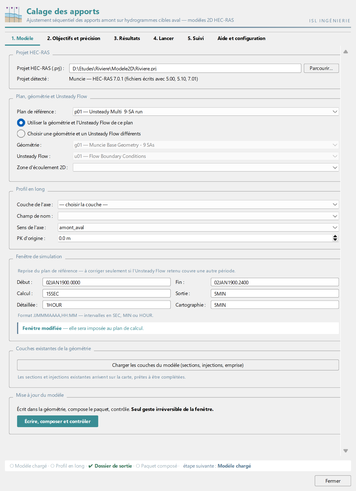
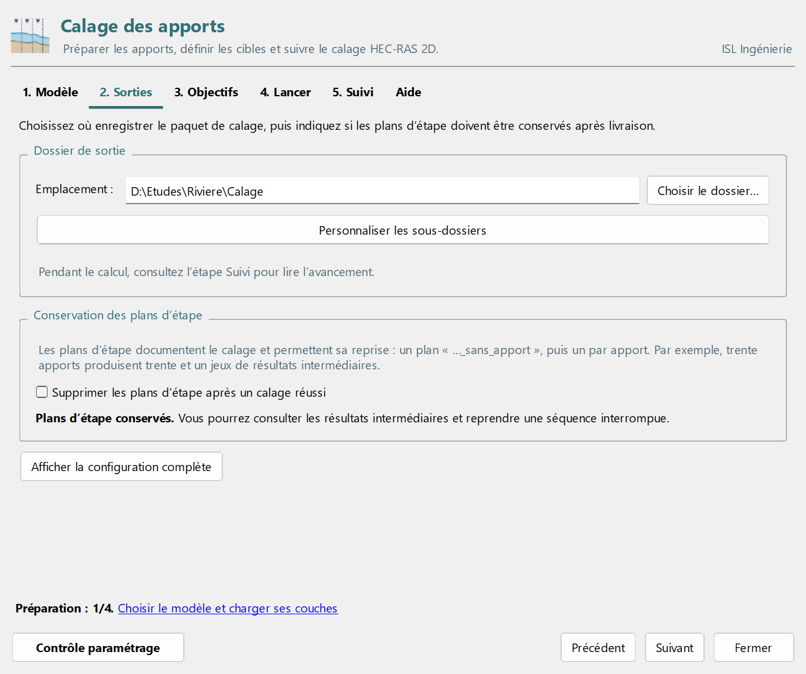
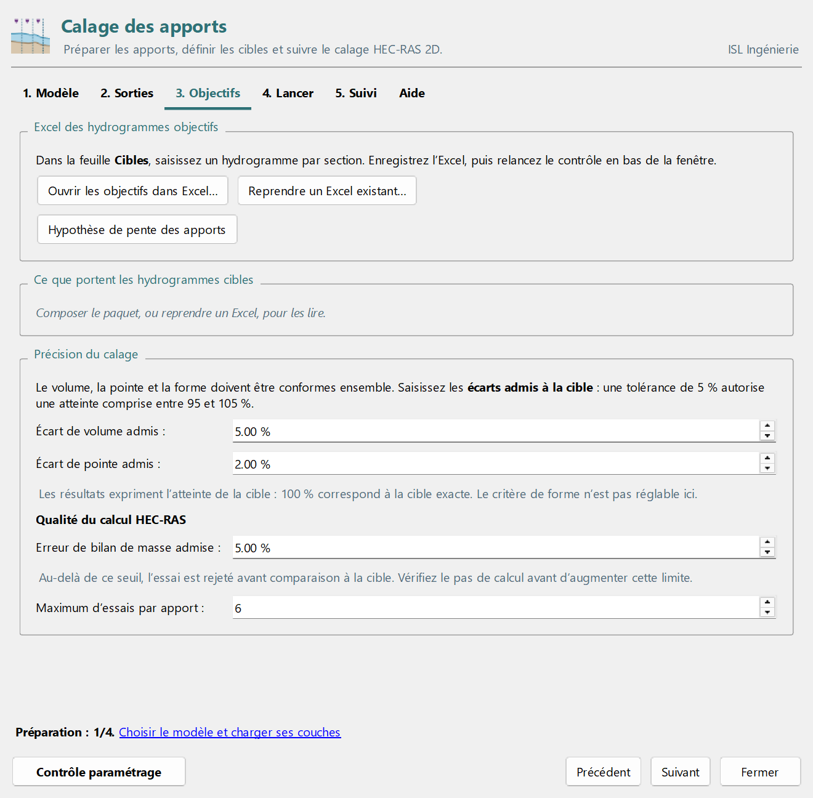
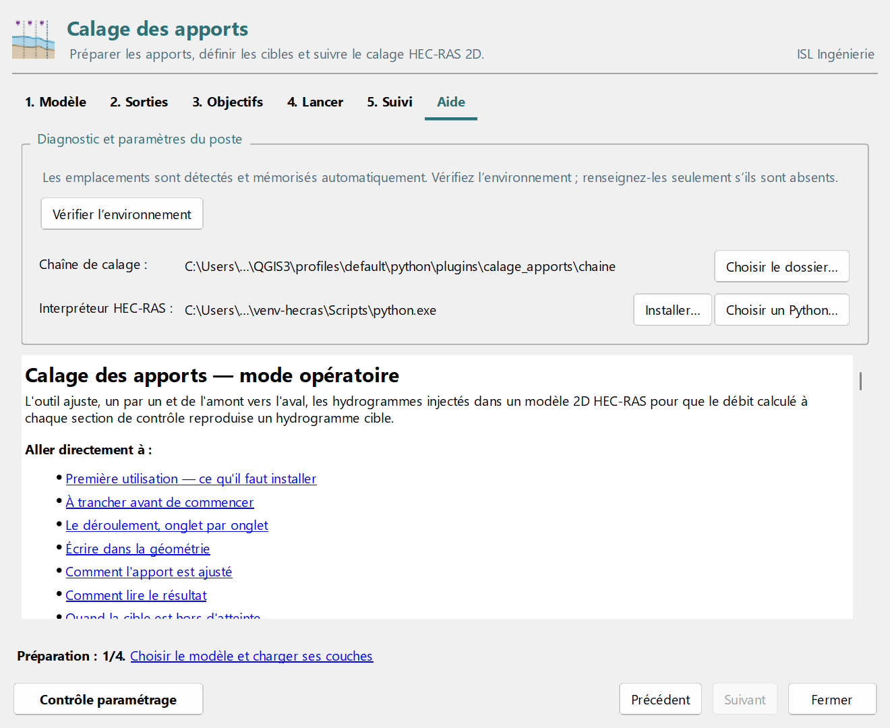

# Calage_apports

Ajustement séquentiel d'apports amont sur des hydrogrammes cibles aval, pour
les modèles 2D HEC-RAS — chaîne Python + plugin QGIS. Projet ISL Ingénierie.

Version des sources du plugin : **0.8.4**. La
[note d’ergonomie du 11 septembre 2026](docs/ergonomie_2026-09-11.md)
décrit le parcours, les choix d’interface et les points de recette.

La version 0.8.0 a passé **248 contrôles Qt** et **30 scénarios d'affichage**
dans QGIS 3.44.8, dont petites fenêtres, thème sombre et écran à 150 %.
La chaîne hydraulique reste inchangée ; aucun nouveau calage réel n'a été
lancé pour cette révision. [Mesures de la recette](docs/ergonomie_2026-09-11-mesures.json).
La **0.8.2** en passe **258, sans échec** : le débordement horizontal de
l'onglet Objectifs à 13 points, présent depuis la 0.8.0, est corrigé.
Elle remplace trois aides dépliables maison par des groupes repliables
QGIS, les boîtes d'information par un bandeau de messages, et retient la
taille de la fenêtre d'une session à l'autre.
La **0.8.3** en passe **270, sans échec** : relancer un calage demande par où
reprendre — les apports déjà calés en amont du départ sont conservés — et
l'onglet Suivi garde le calage précédent au lieu de l'écraser.
La **0.8.4** en passe **278, sans échec** : le préfixe de scénario nomme
l'Excel des objectifs — `donnees_calage_Q100.xlsx` —, si bien que deux
scénarios d'un même dossier de sortie ont deux classeurs ; les erreurs et
avertissements du journal de lancement remontent dans l'onglet Suivi ; et
HEC-RAS ouvert refuse le lancement au lieu de poser une question.

Pour chaque apport, de l'amont vers l'aval : estimer, calculer, comparer à la
cible, corriger, répéter jusqu'à concordance, puis vérifier la cohérence des
sections amont avant de passer au suivant.

**Le réseau ne comporte pas de boucle hydraulique : c'est une hypothèse du
modèle, posée par l'hydraulicien, et rien dans la chaîne ne la vérifie.**
L'ordre total amont → aval est ce qui donne un sens à « section suivante » ;
sur un réseau bouclé — bras qui se rejoignent, casiers interconnectés — un
apport alimenterait plusieurs sections par des chemins distincts, et la
méthode ne s'applique pas. Confirmée par l'hydraulicien le 8 septembre 2026
pour les modèles en cours. Les hypothèses de validité sont au § 1.2 de la
note méthodologique.

Le calage laisse dans le modèle **un plan HEC-RAS par étape** —
`Q100_sans_apport`, `Q100_Apport_A1`… puis `Q100_avec_apports`, qui n'est pas un
clone mais la dernière étape retitrée, avec ses résultats. Ils sont conservés :
ils documentent le calage et permettent de reprendre une séquence interrompue.
Dans **Sorties**, une case permet leur suppression **sur demande**,
uniquement après un calage réussi.

La boucle ([src/calage.py](src/calage.py)) est **indépendante du solveur** : elle
n'en connaît qu'une interface de neuf méthodes, dont six à écrire. Elle est donc
testable sans HEC-RAS, dont la déclinaison vit dans
[src/pilote_hecras.py](src/pilote_hecras.py).

## Démarrage

```bat
REM Un Python ORDINAIRE — surtout pas celui de QGIS : voir ci-dessous.
pip install -r requirements-dev.txt
cd src
python verification_environnement.py
```

`verification_environnement.py` contrôle tout ce qu'exige la mise en œuvre —
interpréteurs, dépendances, fichiers — et nomme ce qui manque.

[requirements-dev.txt](requirements-dev.txt) dit ce qu'il faut pour travailler
sur le code, et surtout ce qui n'y est **pas** : `ras-commander` et `h5py` vivent
dans un interpréteur séparé (conflit HDF5 avec QGIS), `qgis` et `PyQt` viennent
de l'installation QGIS.

Pour saisir les données d'un calage, partir de
[template_donnees_calage.xlsx](template_donnees_calage.xlsx), puis lancer la
chaîne en ligne de commande ou depuis le plugin.

### Avec quel Python ?

Le dépôt en côtoie trois, et les confondre donne des diagnostics qui ressemblent
à des pannes.

| à lancer | avec quoi |
|---|---|
| `verification_environnement.py` | un Python **ordinaire**, ou celui du `venv-hecras` |
| `test_plugin_qgis.py` | le **Python de QGIS** (`python-qgis-ltr.bat`) — il construit la fenêtre |
| les auto-tests de `src/*.py` | l'un ou l'autre, selon leurs imports |

Sous le Python de QGIS, `verification_environnement.py` rend `DLL load failed
while importing _errors` sur `ras-commander`. **Ce n'est pas une panne** : QGIS
embarque sa propre bibliothèque HDF5, et `h5py` y est inutilisable — c'est
précisément la séparation que le projet impose.

## Structure du dépôt

`src/` porte la chaîne Python. C'est un dossier de développement, pas un paquet
distribué : le plugin en embarque une copie autonome à l'installation.

| Fichier / dossier | Rôle |
|---|---|
| [src/calage.py](src/calage.py) | Boucle de calage séquentiel |
| [src/criteres.py](src/criteres.py) | Analyse pure : recalage temporel, corrélation de forme, diagnostic |
| [src/controle_donnees.py](src/controle_donnees.py) | Validation du classeur et de la chaîne SIG avant tout calcul |
| [src/geometrie.py](src/geometrie.py) | Shapefiles, PK par projection curviligne, écriture dans la géométrie HEC-RAS |
| [src/livrables.py](src/livrables.py) | Graphiques, tableaux, export Excel, note de synthèse |
| [src/suivi.py](src/suivi.py) | Avancement lisible pendant le calcul |
| [src/pilote_hecras.py](src/pilote_hecras.py) | Déclinaison HEC-RAS de l'interface `Modele` |
| [src/pont_hecras.py](src/pont_hecras.py) | Pont en ligne de commande répondant en JSON — `ras-commander` est inimportable dans le processus QGIS |
| [src/creer_template.py](src/creer_template.py) / [src/style_classeur.py](src/style_classeur.py) | Fabrication et mise en forme du classeur de saisie |
| [src/verification_environnement.py](src/verification_environnement.py) | Contrôle de l'environnement |
| [src/faire_zip.py](src/faire_zip.py) | Construit `calage_apports_<version>.zip`, l'archive d'installation — le numéro vient de `metadata.txt`, et l'archive précédente est retirée |
| [src/essai_garde_fou_archive.py](src/essai_garde_fou_archive.py) | Essai **adverse** : injecte trois fautes dans l'archive et vérifie qu'elles sont refusées |
| [src/test_plugin_qgis.py](src/test_plugin_qgis.py) | Suite du plugin, sous le Python de QGIS et sur une **copie** d'un modèle — elle **modifie** la géométrie de celui qu'on lui donne (voir ci-dessous) |
| [src/reference_calage_fictif.json](src/reference_calage_fictif.json) | Sortie figée d'un calage sur `ModeleFictif`, comparée à chaque passage du banc. **Ne pas modifier à la main** : `python calage.py --figer-reference` la réécrit |
| [src/elaguer_projet.py](src/elaguer_projet.py) | Rattrapage : élague les plans laissés par l'**ancienne** chaîne |
| [src/reconstruire_livrables.py](src/reconstruire_livrables.py) | Rattrapage : reconstruit les livrables d'un calage **terminé**, en lecture seule sur le modèle |
| [src/captures_plugin.py](src/captures_plugin.py) | Refait les six captures de ce README, sous le Python de QGIS — une capture périmée ressemble à une capture |
| `src/figures_note/` | Reconstruction de la note méthodologique |
| [methodologie_calage_amont_aval.docx](methodologie_calage_amont_aval.docx) | Note méthodologique : mode opératoire, méthode, application HEC-RAS/QGIS, livrables |
| `calage_apports_<version>.zip` | **L'archive à installer dans QGIS** — son nom porte la version, prête à l'emploi |
| `calage_apports/` | Sources du plugin QGIS — voir son [LISEZMOI.md](calage_apports/LISEZMOI.md) |
| [STATUT.txt](STATUT.txt) | État courant et règles en vigueur — la référence pour le détail |
| `charte/` | Identité graphique ISL Ingénierie |

### Lancer la suite du plugin

```bat
"…\bin\python-qgis-ltr.bat" test_plugin_qgis.py --modele "<dossier du modèle>"
```

Sans `--modele`, elle tourne quand même et annonce ce qu'elle saute. `--plan` et
`--geometrie` se déduisent du dossier — mais la déduction prend le **premier**
fichier par ordre alphabétique : les passer explicitement dès qu'un projet porte
plusieurs plans. `--objet <nom d'une condition limite>` ouvre une section de
plus. Le modèle doit porter au moins une ligne d'injection et une ligne de
référence, la seconde en **aval** de la première.

## La fenêtre du plugin

Six rubriques : **Modèle → Sorties → Objectifs → Lancer → Suivi**, puis
**Aide et configuration**. Les commandes de navigation et **Contrôle paramétrage** restent
accessibles en bas de la fenêtre. Les pages longues défilent ; les détails
secondaires se déplient à la demande. Les images sont produites avec un
projet de démonstration par [src/captures_plugin.py](src/captures_plugin.py).

**1. Modèle** — le projet HEC-RAS (**on désigne le fichier `.prj`, pas le
dossier**), le plan de référence, la géométrie, la zone 2D, le **profil en
long** — l'axe, son sens, le PK d'origine — et la fenêtre de simulation. C'est
d'ici que les couches du modèle arrivent sur la carte, éditables. Ce qu'on
y dessine est écrit dans la géométrie par le bouton du bas.



**2. Sorties** — dossier de sortie, sous-dossiers personnalisables et
configuration complète consultable à la demande. Les plans d’étape sont
**conservés par défaut** ; la case de suppression précise son effet et ne
s’applique qu’après un calage réussi.



**3. Objectifs** — ouvrir ou reprendre l’Excel des hydrogrammes objectifs,
puis vérifier **ce que ces hydrogrammes portent** une fois l’Excel validé :
débit de pointe, heure du pic
et volume de chaque apport. Une cible collée dans la mauvaise colonne, un
facteur d'unité ou une colonne restée vide s'y voient avant les heures de
calcul. La précision distingue l’**écart admis à la cible** de l’erreur de
bilan de masse HEC-RAS. Le nombre maximal d’essais reste réglable ; le
résultat se lit en pourcentage d’atteinte de la cible.



**4. Lancer** — l'appariement apport → section, l'état des cibles, le premier
apport à caler, le **préfixe de scénario** — **obligatoire** : sans lui, caler
le Q10 après le Q100 sur le même modèle effacerait les plans du Q100 —, puis le
lancement, expliqué avant son activation. Un accès direct permet de
consulter le suivi.


**5. Suivi** — où en est le calcul, apport par apport, rafraîchi tout seul. Le
dossier surveillé est nommé en permanence : c'est celui que désigne l'Excel
lancé. Les champs de **Sorties** préparent la prochaine composition. La
courbe porte la cible et la section de l’apport en cours, et **derrière,
en vert pointillé, les sections déjà
calées** : c'est la famille de courbes qui dit si tout se tient.


**Aide et configuration** — diagnostic et paramètres du poste immédiatement accessibles,
puis mode opératoire avec sommaire et pièges connus. Les emplacements de la
chaîne de calage et de l’interpréteur HEC-RAS y restent configurables.



Le bouton **« Contrôle paramétrage »** est permanent, au bas de la fenêtre à
côté de *Fermer* : il consomme les trois premiers onglets et prépare le
quatrième, il n'appartient donc à aucun. Il écrit dans la géométrie HEC-RAS,
compose le paquet et lance les contrôles, dans cet ordre — et la première de
ces trois choses est le seul geste irréversible de la fenêtre. **Vert** dès
que tout ce qu'il consomme est prêt, **gris** tant qu'il manque quelque
chose. L’état de préparation indique ce qu’il reste à renseigner ; le
contrôle conserve ses garde-fous métier.

La recette et la construction du ZIP sont distinctes de cette description
de l’interface. Le bilan courant est consigné dans [STATUT.txt](STATUT.txt).

## Licence

Le plugin (`calage_apports/`) est distribué sous GPL-2.0-or-later — voir
[calage_apports/LICENSE.txt](calage_apports/LICENSE.txt). Copyright © 2026
ISL Ingénierie.
