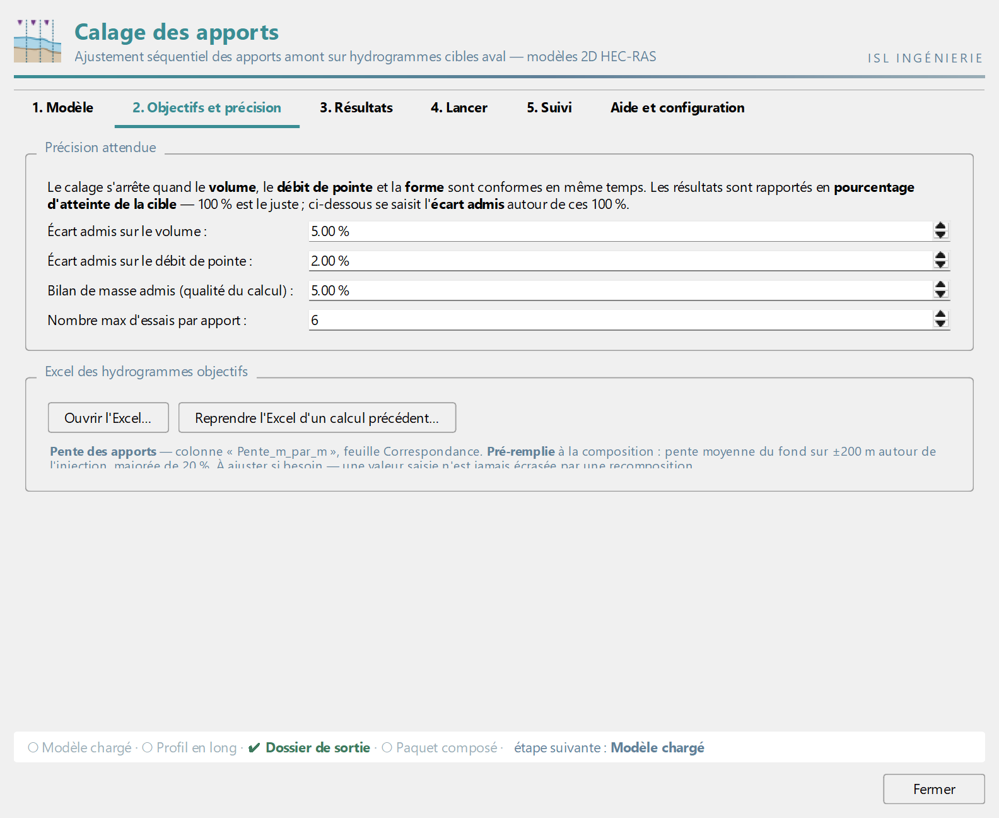
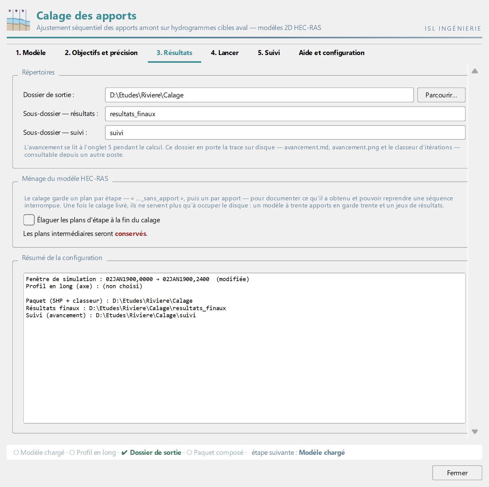
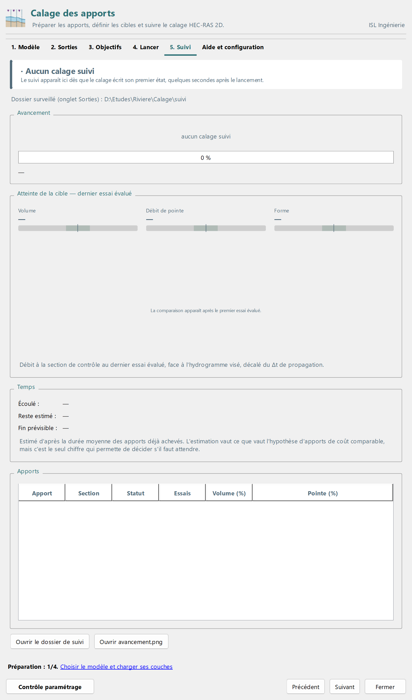

# Calage_apports

Ajustement séquentiel d'apports amont sur des hydrogrammes cibles aval, pour
les modèles 2D HEC-RAS — chaîne Python + plugin QGIS. Projet ISL Ingénierie.

Pour chaque apport, de l'amont vers l'aval : estimer, calculer, comparer à
la cible, corriger, répéter jusqu'à concordance, puis vérifier la cohérence
des sections amont avant de passer au suivant. La boucle de calage
([src/calage.py](src/calage.py)) est indépendante du solveur — elle ne
connaît de lui qu'une interface de huit méthodes — six obligatoires, deux qui
ont un comportement par défaut — ce qui la rend testable sans HEC-RAS. La
déclinaison HEC-RAS vit dans [src/pilote_hecras.py](src/pilote_hecras.py).

## Démarrage

```bat
REM Un Python ORDINAIRE — surtout pas celui de QGIS : voir plus bas.
pip install -r requirements-dev.txt
cd src
python verification_environnement.py
```

[requirements-dev.txt](requirements-dev.txt) dit ce qu'il faut pour travailler
sur le code — et surtout ce qui n'y est **pas** : `ras-commander` et `h5py`
vivent dans un interpréteur séparé (conflit HDF5 avec QGIS), `qgis` et `PyQt`
viennent de l'installation QGIS.

`verification_environnement.py` vérifie ensuite tout ce qui est nécessaire à
la mise en œuvre (interpréteurs, dépendances, fichiers du projet) et
diagnostique les manques.

> **Avec quel Python ?** La question n'est pas de forme : ce dépôt en côtoie
> trois, et les confondre donne des diagnostics qui ressemblent à des pannes.
>
> | à lancer | avec quoi | pourquoi |
> |---|---|---|
> | `verification_environnement.py` | un Python **ordinaire** (ou celui du `venv-hecras`) | il sonde `ras-commander`, que le Python de QGIS ne peut pas importer |
> | `test_plugin_qgis.py` | le **Python de QGIS** (`python-qgis-ltr.bat`) | il construit la fenêtre du greffon, donc il lui faut `qgis.core` |
> | les auto-tests de `src/*.py` | l'un ou l'autre, selon leurs imports | `calage.py` et `criteres.py` n'ont besoin que de la chaîne |
>
> Lancé sous le Python de QGIS, `verification_environnement.py` rend
> `DLL load failed while importing _errors` sur `ras-commander`. **Ce n'est
> pas une panne** : c'est exactement la séparation que le projet impose —
> QGIS embarque sa propre bibliothèque HDF5, et `h5py` y est inutilisable.
> Le message a l'air d'un défaut d'installation ; il n'en est pas un.

Pour saisir les données d'un calage, partir de
[template_donnees_calage.xlsx](template_donnees_calage.xlsx) (produit par
[src/creer_template.py](src/creer_template.py)), puis lancer la chaîne en
ligne de commande ou depuis le plugin QGIS.

## Structure du dépôt

`src/` porte toute la chaîne Python. C'est un dossier de développement, pas
un paquet distribué : le plugin QGIS en embarque une copie autonome à
l'installation (voir plus bas).

| Fichier / dossier | Rôle |
|---|---|
| [src/calage.py](src/calage.py) | Boucle de calage séquentiel |
| [src/criteres.py](src/criteres.py) | Analyse pure : recalage temporel, KGE et composantes |
| [src/controle_donnees.py](src/controle_donnees.py) | Validation du classeur et de la chaîne SIG avant tout calcul |
| [src/geometrie.py](src/geometrie.py) | Shapefiles, PK par projection curviligne, écriture dans la géométrie HEC-RAS |
| [src/livrables.py](src/livrables.py) | Graphiques, tableaux, export Excel, note de synthèse |
| [src/suivi.py](src/suivi.py) | Avancement lisible pendant le calcul (markdown + png) |
| [src/pilote_hecras.py](src/pilote_hecras.py) | Déclinaison HEC-RAS de l'interface `Modele` |
| [src/pont_hecras.py](src/pont_hecras.py) | Pont en ligne de commande répondant en JSON — ras-commander est inimportable dans le processus QGIS |
| [src/elaguer_projet.py](src/elaguer_projet.py) | Rattrapage : élague les plans laissés par l'**ancienne** chaîne. Les plans d'étape de la chaîne actuelle sont conservés exprès, et il ne les voit pas |
| [src/reconstruire_livrables.py](src/reconstruire_livrables.py) | Rattrapage : reconstruit les livrables d'un calage **terminé** dont le rapport s'est perdu, depuis son plan final — en lecture seule sur le modèle |
| [src/verification_environnement.py](src/verification_environnement.py) | Contrôle de tout ce qui est nécessaire à la mise en œuvre |
| [src/creer_template.py](src/creer_template.py) / [src/style_classeur.py](src/style_classeur.py) | Fabrication et mise en forme du classeur de saisie |
| [src/faire_zip.py](src/faire_zip.py) | Construit `calage_apports.zip`, l'archive d'installation du plugin |
| [src/essai_garde_fou_archive.py](src/essai_garde_fou_archive.py) | Essai **adverse** : injecte trois fautes dans l'archive et vérifie qu'elles sont refusées |
| [src/test_plugin_qgis.py](src/test_plugin_qgis.py) | Suite du plugin (**172 contrôles au 06/09**), à lancer sous l'interpréteur de QGIS et sur une **copie** d'un modèle — la suite **modifie** la géométrie de celui qu'on lui donne. Sans `--modele`, elle tourne quand même et annonce ce qu'elle saute ; avec, il lui faut aussi `--plan`, `--geometrie` et `--objet <nom d'une condition limite>`. Le modèle doit porter au moins une ligne d'injection et une ligne de référence, la seconde en **aval** de la première |
| `src/figures_note/` | Reconstruction de la note méthodologique : contenu, figures, assemblage du `.docx` |
| [methodologie_calage_amont_aval.docx](methodologie_calage_amont_aval.docx) | Note méthodologique (mode opératoire, méthode générale, application HEC-RAS/QGIS, livrables) |
| `calage_apports/` | Plugin QGIS — voir son propre [LISEZMOI.md](calage_apports/LISEZMOI.md) (installation, tests, contraintes d'environnement) |
| `livrables_exemple/` | Sortie d'exemple produite par `python livrables.py` — régénérée à chaque exécution, **absente d'un dépôt fraîchement cloné** (hors suivi git depuis le 31/08/2026) |
| [src/reference_calage_fictif.json](src/reference_calage_fictif.json) | Sortie figée d'un calage complet sur `ModeleFictif` — le test de caractérisation de `caler()` la compare à chaque passage du banc. **Ne pas modifier à la main** : `python calage.py --figer-reference` la réécrit quand le changement est voulu |
| [AUDIT.md](AUDIT.md) | Audit de complexité du 5 septembre 2026 — constats mesurés, ce qu'il ne faut **pas** simplifier, et le plan par lots |
| `charte/` | Identité graphique ISL Ingénierie |
| [docs/ergonomie_2026-09-06.md](docs/ergonomie_2026-09-06.md) | Recherche d'ergonomie sur la fenêtre : six lectures indépendantes de `plugin.py`, puis une passe de réfutation. Ce qui a été corrigé, ce qu'il ne faut **pas** toucher, et ce qu'aucune lecture de code ne tranchera |
| [NOTE_SESSION_2026-09-05_poste_neuf.md](NOTE_SESSION_2026-09-05_poste_neuf.md) | Ce qu'un poste neuf a appris au projet : montage de l'environnement, passage des 172 contrôles, et les sept défauts du banc qu'il a fallu lever pour y arriver |
| `docs/` | Notes de travail annexes |
| `_arquivo/` | Versions obsolètes de documents, hors du chemin de lecture normal |

## État du projet

**Trois calages multi-apports sont allés à leur terme, conformes** — six, douze
et six apports, **vingt-quatre en tout**, zéro incident. La plupart ont convergé
en un ou deux essais. Ce qu'ils ont appris est aux sections 5.6 et 5.7 de
`STATUT.txt`.

**Plugin QGIS en 0.7.14.** Ses six onglets suivent l'ordre des décisions :
Modèle, Objectifs et précision, Résultats, Lancer, Suivi, Aide et
configuration.

**La suite du greffon passe de bout en bout** : **172 contrôles, aucun
échec**, le 6 septembre 2026 sur un poste neuf, avec un modèle et un
interpréteur HEC-RAS. Elle n'y arrivait pas : sept défauts du **banc**
l'en empêchaient, tous du même motif — *il supposait le modèle et le poste
de son auteur*. Le plus parlant : `EPSG:2154` déclaré en dur pour des
coordonnées réelles, ce qui ne pouvait pas se voir sur un modèle français.
Détail dans `NOTE_SESSION_2026-09-05_poste_neuf.md`.

**Le lot 5 d'`AUDIT.md` est fait** : `_sections_derivees` corrigé, `caler()`
ramené de 699 à 622 lignes par deux extractions en déplacement pur — le test
de caractérisation est resté identique à chaque pas. La troisième extraction
que l'audit envisageait est **écartée sur mesure** (quinze variables locales
à passer) ; ce qui reste du poids de `caler()` relève du chantier « calage
simultané », pas de l'extraction.

**Ce qui reste** est au § 7 de `NOTE_SESSION_2026-09-05_poste_neuf.md` :
trois garde-fous jamais rencontrés par un calage réel, et l'hypothèse
d'ordre total dont dépend le calage simultané — une question
d'hydraulicien, pas de code.

[STATUT.txt](STATUT.txt) porte l'état courant et les règles en vigueur —
c'est la référence à jour, plus fiable que ce README pour le détail.
[CHECKPOINT.md](CHECKPOINT.md) est le point de reprise entre sessions de
travail.

## La fenêtre du greffon

Six onglets, dans l'ordre des décisions. Captures prises sur la version
0.7.14, modèle d'exemple, chemins neutralisés.

### 1. Modèle
Le projet HEC-RAS — **on désigne le fichier `.prj`, pas le dossier** —, le
plan de référence, la géométrie, la zone 2D, l'axe hydraulique et la fenêtre
de simulation. C'est aussi d'ici que les couches du modèle arrivent sur la
carte, éditables.


### 2. Objectifs et précision
Ce qu'on vise et avec quoi : l'**écart admis** sur le volume et sur le débit
de pointe — le résultat, lui, se lit en pourcentage d'atteinte de la cible —,
le nombre maximal d'essais, et le classeur où se saisissent les hydrogrammes.



### 3. Résultats
Dossiers de sortie et de suivi, relecture d'un hydrogramme déjà calculé, et
le résumé de toute la configuration.



### 4. Lancer
L'appariement apport → section, l'état des cibles, le premier apport à caler
et le **préfixe de scénario** — sans lui, caler le Q10 après le Q100 sur le
même modèle efface les plans du Q100.


### 5. Suivi
Où en est le calcul, apport par apport, rafraîchi tout seul. Le dossier
surveillé est nommé en permanence : c'est celui que désigne le **classeur
lancé**, pas celui de l'onglet 3.



### Aide et configuration
Le mode opératoire, avec un sommaire pour l'atteindre, les pièges connus, et
les deux emplacements du poste — chaîne de calage et interpréteur HEC-RAS.


Le bouton **« Écrire, composer et contrôler »**, permanent en bas, nomme les
trois choses qu'il fait, dans l'ordre où il les fait — et la première,
l'écriture dans la géométrie HEC-RAS, est la seule irréversible.

## Licence

Le plugin QGIS (`calage_apports/`) est distribué sous GPL-2.0-or-later —
voir [calage_apports/LICENSE.txt](calage_apports/LICENSE.txt). Copyright ©
2026 ISL Ingénierie.
